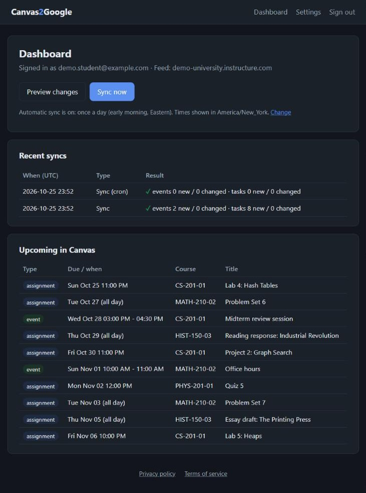
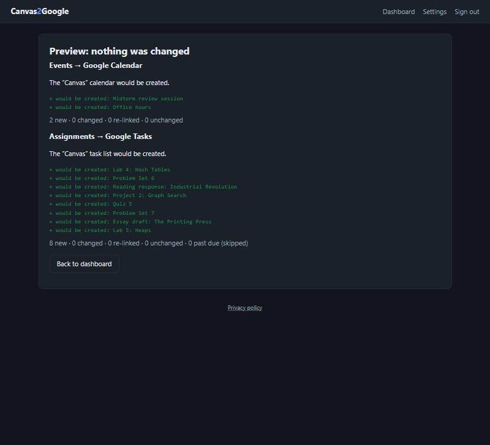
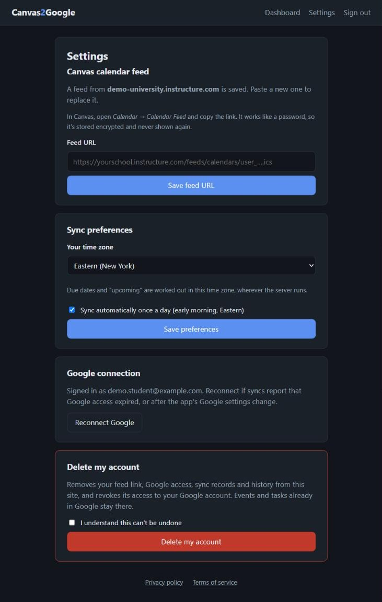
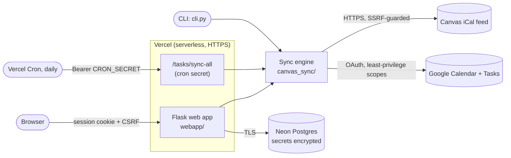

# Canvas2Google

[](https://github.com/channel-noah/canvas2google/actions/workflows/ci.yml)

**Automatically syncs Canvas LMS assignments to Google Tasks and Canvas events to Google Calendar.**

Canvas only offers a read-only calendar feed, so due dates never show up in the tools students actually use. Canvas2Google reads that feed and keeps a dedicated **"Canvas"** Google Calendar and a **"Canvas"** Google Tasks list up to date: creating new items, updating changed ones, and never making duplicates.

It runs as a **web app** (Flask on Vercel, Postgres on Neon, a daily scheduled sync) and as a **command-line tool**, both built on the same sync engine. I built it as a cybersecurity portfolio project, so the security design is as much the point as the features. See **[THREAT_MODEL.md](THREAT_MODEL.md)**.

> Live at **https://canvas2google.vercel.app**. Sign-in is currently limited to an allowlist (single user) while the Google OAuth app awaits verification.



---

## Features

- **Assignments → Google Tasks**, with the exact due time in the task notes (Google Tasks only stores dates).
- **Events → Google Calendar**, in a separate calendar the app creates and owns.
- **Updates, not duplicates.** Changed titles, dates and descriptions are patched in place. Checked-off tasks stay checked off.
- **Preview before syncing.** A dry run shows exactly what *would* change, using only read requests.
- **Automatic syncing**: a daily cron in the cloud, or an in-app scheduler when self-hosted.
- **Per-user time zones**, so "due Thursday at 11 PM" doesn't become Friday on a UTC server.
- **Privacy controls**: a public privacy policy, and one-click **Delete my account** (removes all data and revokes Google access).

| Preview (dry run) | Settings |
|---|---|
|  |  |

*Screenshots use fake demo data from [`scripts/demo_server.py`](scripts/demo_server.py).*

## Architecture



```
canvas_sync/      Shared sync engine (no web code)
  feed.py           Fetch (HTTPS, size/timeout limits, no redirects) and parse the iCal feed
  text.py           HTML → plain text; strips script/style and terminal control characters
  calendar_sync.py  Events → Google Calendar (create / patch / re-link / dry run)
  tasks_sync.py     Assignments → Google Tasks
  state.py          Sync records + content fingerprints (versioned, migrated)
  config.py         Strict feed-URL validation (SSRF allowlist)
webapp/           Flask app: Google sign-in, encryption, database, pages, cron endpoint
cli.py            Command-line front end
app.py            Vercel entry point
tests/            Test suite (network blocked; fake Google services)
```

### How syncing stays correct

- **Stable identity.** Each Canvas item's iCal `UID` maps to its Google event or task ID in a per-user state record.
- **Content fingerprints.** A SHA-256 hash of what was last sent to Google means unchanged items cost **zero API calls**, and changed items get a minimal `PATCH`.
- **Self-healing.** Every Google item carries its Canvas UID: a hidden event property, or a notes line for tasks. If the state record is lost, items are **re-linked instead of duplicated**.
- **One sync at a time.** A per-user lock taken with a single atomic conditional `UPSERT` works the same on SQLite and Postgres, across processes, and expires if a sync crashes.

## Security design

| Area | What's done |
|---|---|
| **Least privilege** | Google scopes are `calendar.app.created` (can only touch calendars this app created; verified by a 403 on others) and `tasks`. Partial consent is detected and refused. |
| **Authentication** | Google sign-in with `state` + **PKCE**, server-side code exchange, verified ID token, and an **email allowlist checked before anything is stored**. A fresh session starts on sign-in. |
| **Secrets at rest** | Feed URLs and Google tokens are **encrypted with Fernet** (AES + HMAC). The key lives outside the database, and each ciphertext is **bound to its user row** so it can't be moved to another account. |
| **Web hardening** | CSRF tokens; **CSP with no scripts at all**; `__Host-` Secure/HttpOnly/SameSite cookies; HSTS; no framing; no stack traces; auto-escaped templates. |
| **SSRF** | The server only fetches `https://*.instructure.com/feeds/calendars/*.ics`, never follows redirects, and rejects metadata IPs, credentials in URLs, odd ports and lookalike domains. |
| **Untrusted input** | Canvas content is treated as hostile: HTML is parsed, never rendered; control characters are stripped (no terminal escape injection); size and length caps apply. |
| **Abuse controls** | Database-backed rate limits (sign-in per IP, syncs and Canvas fetches per user, lockout after wrong cron secrets), with IPs stored only as keyed hashes. A user cap, and an invite-only or open sign-up mode. |
| **Key rotation** | `APP_ENCRYPTION_KEY=NEW,OLD` (MultiFernet): new data uses the newest key, the daily sync re-encrypts the rest, then the old key is removed. |
| **Multi-user isolation** | Tests prove one user can't see, change or delete another's data, and no route takes a user ID. |
| **Secret hygiene** | Nothing secret was ever committed (full-history scans before every push, using a scanner that is **self-tested against a known fake**). Errors never echo URLs or tokens. OAuth codes are redacted from request logs. |
| **Supply chain** | Every dependency pinned; Dependabot proposes updates weekly. CI pins GitHub Actions to exact commits and runs with read-only permissions. `pip-audit` clean. `bandit` clean, with three documented suppressions: one false positive, plus two deliberately fake values in the demo script. |

The full analysis (assets, trust boundaries, 30 threats, 14 remaining risks, and incidents caught during development) is in **[THREAT_MODEL.md](THREAT_MODEL.md)**.

## Testing

```bash
pip install -r requirements.txt -r requirements-dev.txt
pytest --cov=canvas_sync --cov=webapp
```

- **191 tests, about 92% coverage, runs in a few seconds.**
- **The network is blocked inside every test**, so nothing can reach Canvas or a real Google account. Google is replaced by in-memory fakes that record every write and mimic `PATCH` semantics.
- Covers parsing edge cases, sync behavior (create / no-op / update / dry run / re-link / recreate), sign-in rules (bad `state`, non-allowlisted accounts, missing scopes), CSRF, encryption at rest, XSS escaping, SSRF inputs, the cron secret, HTTPS cookie flags, time zones across DST, and lock exclusivity across connections.
- **The tests themselves were tested** by deliberately planting bugs (disabling CSRF, removing the allowlist, breaking the lock, dropping the time zone). Every one was caught, and one gap was found and fixed along the way.

GitHub Actions runs the tests, `bandit` and `pip-audit` on every push, using Python 3.12 like production ([`ci.yml`](.github/workflows/ci.yml)).

Security checks:

```bash
pip-audit -r requirements.txt
bandit -r canvas_sync webapp cli.py app.py scripts
```

## Running it yourself

You'll need Python 3.12+, a Canvas calendar feed link, and a Google Cloud project with the Calendar and Tasks APIs enabled.

**Demo with fake data** (no accounts needed):

```bash
python scripts/demo_server.py          # then open http://127.0.0.1:5050/demo-login
```

**Command line:**

```bash
python -m venv .venv && source .venv/bin/activate   # Windows: .venv\Scripts\activate
pip install -r requirements.txt
cp .env.example .env            # add CANVAS_FEED_URL; put a Desktop OAuth client in credentials.json
python cli.py                   # list upcoming items
python cli.py --dry-run         # preview changes
python cli.py --sync-events --sync-tasks
```

**Web app locally:** fill in the web settings in `.env` (see [`.env.example`](.env.example)), then:

```bash
flask --app webapp run                                         # http://localhost:5000
flask --app "webapp:create_app(start_scheduler=True)" run       # with automatic syncing
```

**Deploying to Vercel:** import the repo, connect a Neon Postgres database (Production only), and set the environment variables from `.env.example` plus `SECURE_COOKIES=true`, `OAUTH_REDIRECT_URI` and `CRON_SECRET`. [`vercel.json`](vercel.json) schedules the daily sync. The app refuses to start on Vercel without Postgres, rather than silently losing data.

## Lessons from building it

A few things the project taught me, each written up in [THREAT_MODEL.md §5](THREAT_MODEL.md#5-findings-and-incidents-during-development):

- **A security check you haven't seen fail proves nothing.** A secret-scan pattern was silently broken by shell quoting, and was only caught because a test fixture contained a known fake token.
- **Verify configuration from the outside.** After a dashboard redeploy, the live site was still using a stale OAuth redirect. I caught it by inspecting the real sign-in redirect before anyone signed in.
- **Security controls interact.** A strict `Referrer-Policy: no-referrer` would have broken every form in production, because the CSRF library checks the `Referer` header over HTTPS.
- **Rotate anything that might be exposed.** An OAuth client secret appeared in automation screenshots and was rotated the same day.

### Rotating the encryption key

1. Generate a key: `python -c "from cryptography.fernet import Fernet; print(Fernet.generate_key().decode())"`
2. Set `APP_ENCRYPTION_KEY=NEW_KEY,OLD_KEY` and redeploy.
3. After the next daily sync (or `flask --app webapp rotate-keys`), everything is under the new key.
4. Set `APP_ENCRYPTION_KEY=NEW_KEY` and redeploy.

## Roadmap

- Google OAuth verification for the Tasks scope, then switching `SIGNUP_MODE` to `open`.
- Monitoring and alerts for failed syncs.

## About

Built by **Noah ([@channel-noah](https://github.com/channel-noah))**, a cybersecurity student, as a hands-on project in Python, APIs, OAuth and secure web development, working with an AI pair programmer ([Claude Code](https://claude.com/claude-code)). Not affiliated with Instructure or Google.

## License

[MIT](LICENSE)
